

<picture><source media="(prefers-color-scheme: dark)" srcset="assets/hero-dark.svg"><source media="(prefers-color-scheme: light)" srcset="assets/hero-light.svg"></picture>

 

<a href="#now"><b>Now</b></a> &nbsp;·&nbsp; <a href="#packages"><b>Packages</b></a> &nbsp;·&nbsp; <a href="#projects"><b>Projects</b></a> &nbsp;·&nbsp; <a href="#stack"><b>Toolkit</b></a> &nbsp;·&nbsp; <a href="#activity"><b>Activity</b></a> &nbsp;·&nbsp; <a href="#contact"><b>Contact</b></a>

 

<picture><source media="(prefers-color-scheme: dark)" srcset="assets/section-now-dark.svg"><source media="(prefers-color-scheme: light)" srcset="assets/section-now-light.svg"></picture>

I'm **Ashkan**, a mobile engineer with **8+ years** shipping Flutter, Kotlin and Swift apps.
These days I work where mobile meets AI: **models that run on the device**, **agents that act on their own**, and **interfaces that feel alive**.

| &nbsp;Shipping | &nbsp;Exploring | &nbsp;Open to |
| :-- | :-- | :-- |
| [`generative_shader_ui`](https://pub.dev/packages/generative_shader_ui) 1.1: GPU shader widgets for Flutter | On-device LLM inference in pure Dart | Mobile & AI engineering roles |
| [`device_finder`](https://pub.dev/packages/device_finder): offline BLE tracking with Kalman-filtered RSSI | Autonomous agents with LangGraph, Gemini & Ollama | Freelance projects & OSS collaborations |

 

<picture><source media="(prefers-color-scheme: dark)" srcset="assets/section-packages-dark.svg"><source media="(prefers-color-scheme: light)" srcset="assets/section-packages-light.svg"></picture>

<a href="https://pub.dev/packages/generative_shader_ui#gh-dark-mode-only">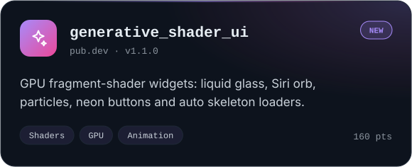</a><a href="https://pub.dev/packages/generative_shader_ui#gh-light-mode-only">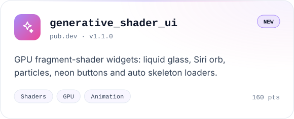</a>
<a href="https://pub.dev/packages/device_finder#gh-dark-mode-only">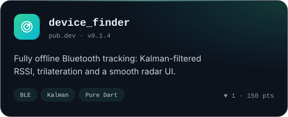</a><a href="https://pub.dev/packages/device_finder#gh-light-mode-only">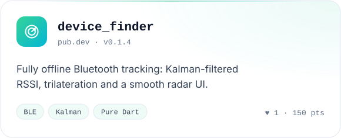</a>
<a href="https://pub.dev/packages/rehoboam_neural_ui#gh-dark-mode-only">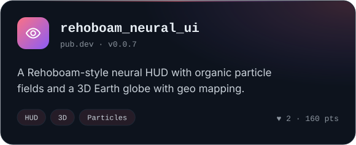</a><a href="https://pub.dev/packages/rehoboam_neural_ui#gh-light-mode-only">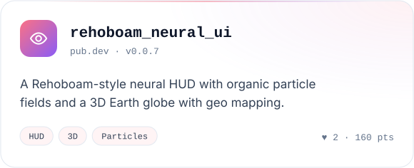</a>
<a href="https://pub.dev/packages/ollama_easy#gh-dark-mode-only">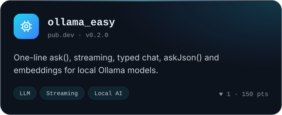</a><a href="https://pub.dev/packages/ollama_easy#gh-light-mode-only">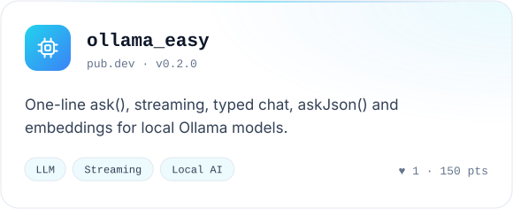</a>
<a href="https://pub.dev/packages/app_bar_search#gh-dark-mode-only">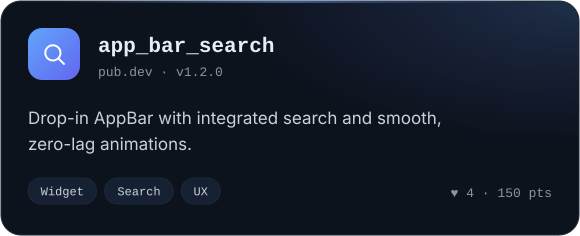</a><a href="https://pub.dev/packages/app_bar_search#gh-light-mode-only">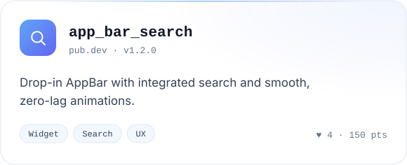</a>
<a href="https://pub.dev/packages/car_license_plate#gh-dark-mode-only">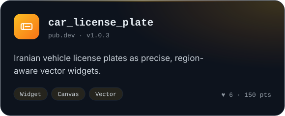</a><a href="https://pub.dev/packages/car_license_plate#gh-light-mode-only">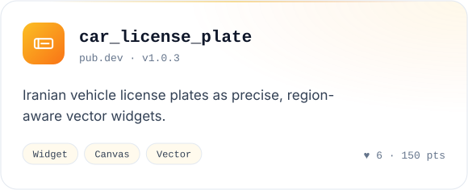</a>

<b>+ 4 more packages</b>

 

| Package | What it does | Live |
| :-- | :-- | :-- |
| [`smart_refresh_token`](https://pub.dev/packages/smart_refresh_token) | Automatic Dio token refresh with request queueing |   |
| [`performance_list_view`](https://pub.dev/packages/performance_list_view) | Pagination, pull-to-refresh, error states, image memory optimisation |   |
| [`azure_speech_recognition_services`](https://pub.dev/packages/azure_speech_recognition_services) | Azure speech-to-text for Flutter |   |
| [`smart_progress_circle`](https://pub.dev/packages/smart_progress_circle) | Customisable, gesture-driven circular progress |   |

 

<picture><source media="(prefers-color-scheme: dark)" srcset="assets/section-projects-dark.svg"><source media="(prefers-color-scheme: light)" srcset="assets/section-projects-light.svg"></picture>

<a href="https://github.com/developerashkan/world_lens#gh-dark-mode-only">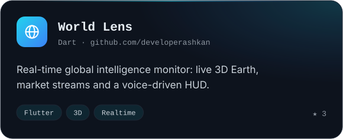</a><a href="https://github.com/developerashkan/world_lens#gh-light-mode-only">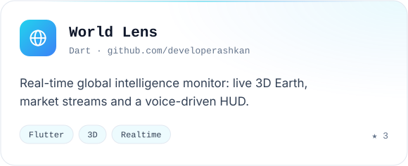</a>
<a href="https://github.com/developerashkan/offline-ai-with-smollm2#gh-dark-mode-only">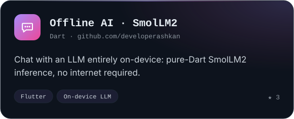</a><a href="https://github.com/developerashkan/offline-ai-with-smollm2#gh-light-mode-only">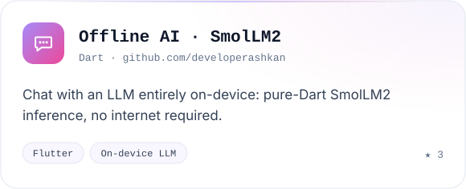</a>
<a href="https://github.com/developerashkan/divar#gh-dark-mode-only">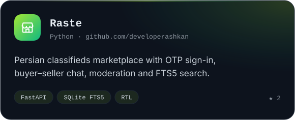</a><a href="https://github.com/developerashkan/divar#gh-light-mode-only">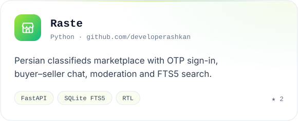</a>
<a href="https://github.com/developerashkan/LocalForge#gh-dark-mode-only">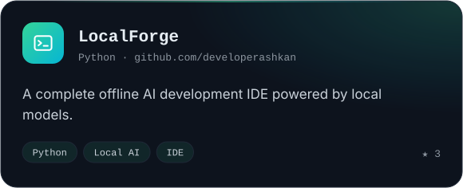</a><a href="https://github.com/developerashkan/LocalForge#gh-light-mode-only">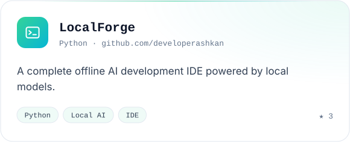</a>
<a href="https://github.com/developerashkan/Local-LLM-Powered-Subtitle-Translator#gh-dark-mode-only">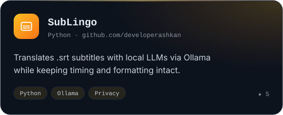</a><a href="https://github.com/developerashkan/Local-LLM-Powered-Subtitle-Translator#gh-light-mode-only">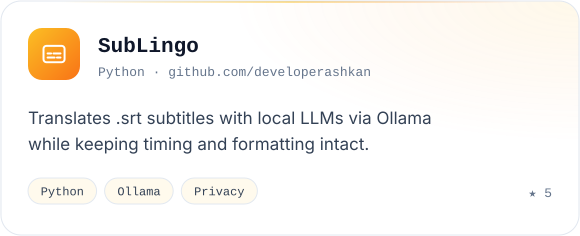</a>
<a href="https://github.com/developerashkan/insight_radar#gh-dark-mode-only">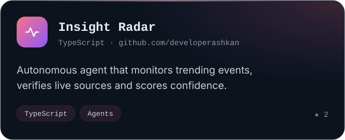</a><a href="https://github.com/developerashkan/insight_radar#gh-light-mode-only">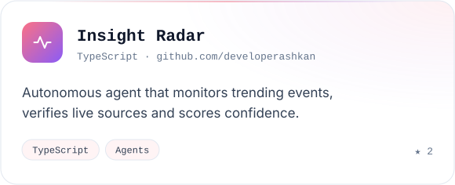</a>
<a href="https://github.com/developerashkan/agentkit#gh-dark-mode-only">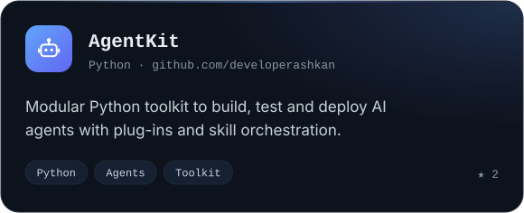</a><a href="https://github.com/developerashkan/agentkit#gh-light-mode-only">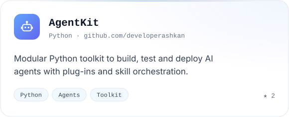</a>

<b>+ 8 more projects</b>

 

| Project | What it does | Stack |
| :-- | :-- | :-- |
| [**gzip_chat**](https://github.com/developerashkan/gzip_chat) | Zero-weight “language model” that writes Shakespeare via zlib compression | `Flutter` |
| [**genui_gemini**](https://github.com/developerashkan/genui_gemini) | Dynamic AI-generated UI with Google Gemini | `Flutter · Gemini` |
| [**ollama_flutter**](https://github.com/developerashkan/ollama_flutter) | Modern chat UI for local Ollama models | `Flutter · Ollama` |
| [**smart_support_agent**](https://github.com/developerashkan/smart_support_agent) | Customer-support agent that routes requests and checks orders | `LangGraph · Gemini` |
| [**crypto_analysis_agent**](https://github.com/developerashkan/crypto_analysis_agent) | Autonomous crypto market analysis agent | `Python` |
| [**LocalMind**](https://github.com/developerashkan/LocalMind) | Jetpack Compose notes with AI suggestions via Ollama | `Kotlin · Compose` |
| [**JobGrabberAgent**](https://github.com/developerashkan/JobGrabberAgent) | Agent that finds jobs matching your request | `TypeScript` |
| [**Gantt-Chart-Generator**](https://github.com/developerashkan/Gantt-Chart-Generator) | Turns plain-text task lists into Gantt charts in the terminal | `Python` |

 

<picture><source media="(prefers-color-scheme: dark)" srcset="assets/section-stack-dark.svg"><source media="(prefers-color-scheme: light)" srcset="assets/section-stack-light.svg"></picture>

| | Tools | How I use them |
| :-- | :-- | :-- |
| **Mobile** |  | Production iOS & Android apps, from custom render objects and shaders to platform channels |
| **AI & agents** |  | Local LLMs (Ollama, SmolLM2), Gemini, LangGraph agents, speech & vision pipelines |
| **Cloud** |  | Auth, realtime data, speech services, containerised backends |
| **Workflow** |  | CI, package publishing, automated releases |

 

<picture><source media="(prefers-color-scheme: dark)" srcset="assets/section-activity-dark.svg"><source media="(prefers-color-scheme: light)" srcset="assets/section-activity-light.svg"></picture>

<picture><source media="(prefers-color-scheme: dark)" srcset="assets/stats-dark.svg"><source media="(prefers-color-scheme: light)" srcset="assets/stats-light.svg">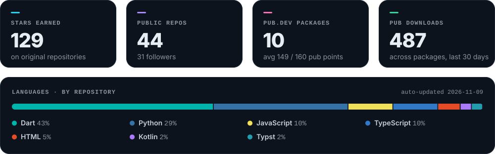</picture>

<picture>
<source media="(prefers-color-scheme: dark)" srcset="https://github-contribution-merger.apoorvdarshan.com/api/merge?users=developerashkan%2Cashkanvit&amp;theme=github-dark">
<source media="(prefers-color-scheme: light)" srcset="https://github-contribution-merger.apoorvdarshan.com/api/merge?users=developerashkan%2Cashkanvit&amp;theme=github">

</picture>
 
Combined contributions · <a href="https://github.com/developerashkan">@developerashkan</a> + <a href="https://github.com/ashkanvit">@ashkanvit</a>

 

<picture><source media="(prefers-color-scheme: dark)" srcset="assets/footer-dark.svg"><source media="(prefers-color-scheme: light)" srcset="assets/footer-light.svg"></picture>

  

Cards and stats are generated by <a href="scripts/build.py"><code>scripts/build.py</code></a> and refreshed weekly by GitHub Actions · <a href="#top">back to top ↑</a>

